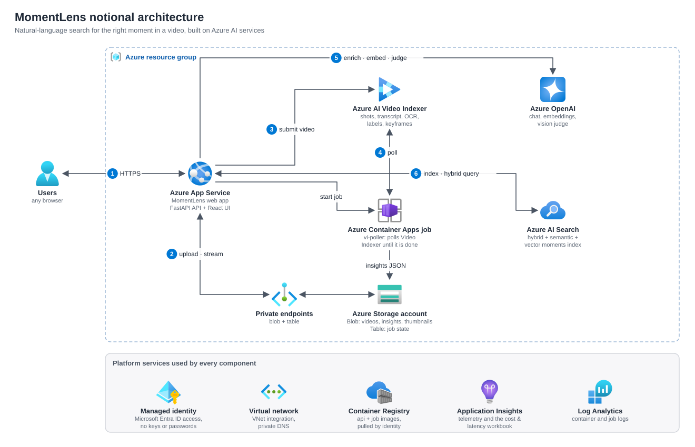

<p align="center">
  
</p>

<h1 align="center">MomentLens</h1>

Find the moment you are looking for in a video. Describe it in plain language, such as *"a scored goal"* or *"the panel
discussion about transport"*, and MomentLens jumps to the right second. Videos are analysed with **Azure AI Video
Indexer**, enriched with **Azure OpenAI**, and searched with hybrid, semantic and vector retrieval in **Azure AI Search**.



## What it does

* **Index** a video you upload (or one that is already in your storage account): shots, transcript, on-screen text,
  labels, people and keyframes come from Video Indexer, and a vision model describes what the frames show.
* **Search** it with natural language. Keyword, vector and semantic ranking are combined, and an LLM judge checks the best
  candidates against their transcript and sampled frames, so a query returns the moment itself rather than commentary
  about it.
* **Tag** events (goals, fouls, cards, ... for the built-in soccer profile; other domains are a small addition) and list
  every tagged moment without calling a model at search time.
* **Play** the video from private storage, seeking to the matched second.
* **Watch** cost and latency per indexing run in an Azure Monitor workbook.

How the pipeline works, step by step: [docs/how-it-works.md](docs/how-it-works.md).

## Notional architecture

1. **Browse.** Users reach the web app over HTTPS. One container on Azure App Service holds the FastAPI service and the
   React UI.
2. **Upload and play.** The API receives uploads block by block and writes them to Azure Blob Storage, and streams videos
   and thumbnails back. Storage is reached through private endpoints and closed to the internet.
3. **Submit.** The API signs a short-lived read-only link with a user delegation key and submits the video to Azure AI
   Video Indexer.
4. **Poll.** It starts the `vi-poller` Azure Container Apps job, which waits for Video Indexer to finish and stores the
   insights JSON in Blob Storage. A job, rather than the web app, so a web app restart never interrupts a long run.
5. **Enrich.** The API turns the insights into scene cards. Azure OpenAI summarises scenes, describes frames, creates
   embeddings and, at search time, rewrites queries and judges candidates (deployments `chat`, `embedding` and `judge`).
6. **Index and query.** Scene cards are indexed in Azure AI Search, which serves the hybrid queries.

Everything authenticates with one **user-assigned managed identity** and Azure RBAC. The platform services in the lower
band of the diagram support every component: Microsoft Entra ID, a virtual network with private DNS, a container
registry, and Application Insights with Log Analytics.

| Azure service | Role in MomentLens |
| --- | --- |
| App Service (Linux, container) | Web app: API and UI |
| Azure AI Video Indexer | Shots, transcript, OCR, labels, keyframes |
| Azure Container Apps (job) | Waits for Video Indexer without tying up the web app |
| Azure OpenAI | Scene summaries, frame descriptions, embeddings, query rewriting, judge |
| Azure AI Search | Hybrid, semantic and vector retrieval over scene cards |
| Storage (Blob, Table) | Videos, insights, thumbnails and job state |
| Container Registry | The two container images |
| Application Insights, Log Analytics | Telemetry, job logs, the cost and latency workbook |


## Deploy to Azure

You need an Azure subscription in which you are **Owner** (or Contributor plus User Access Administrator), the
[Azure CLI](https://learn.microsoft.com/cli/azure/install-azure-cli), and Bash (Azure Cloud Shell works).

```bash
az login
./scripts/deploy.sh          # creates everything, builds the images in the new registry and starts the site
```

The first run takes 15 minutes or more. [docs/deployment.md](docs/deployment.md) lists what is created, every
parameter (regions, models, quota, sizes), troubleshooting and how to tear everything down. The resources start costing
money as soon as they exist: Video Indexer, Azure OpenAI and Azure AI Search are the main drivers.

> **The site is open by default.** MomentLens has no sign-in of its own, so anyone who has the URL can upload videos and
> run searches at your expense. Restrict it with `ALLOWED_CLIENT_IPS="203.0.113.7,198.51.100.0/24" ./scripts/deploy.sh`
> and/or turn on Microsoft Entra authentication for the web app (steps in [docs/deployment.md](docs/deployment.md#protect-the-site)).


## Run it locally

You still need the Azure resources (deploy once), because there is no local emulator for Video Indexer or Azure AI Search.

```bash
python -m venv .venv && source .venv/bin/activate
pip install -e "api[dev]"
cp api/.env.example api/.env          # fill it in from the deployment outputs, then: az login
(cd api && uvicorn app.main:app --reload --port 8000)

# in a second terminal, from the repository root
(cd ui && npm ci && npm run dev)      # http://localhost:5173, proxies /api to :8000
```

`ffmpeg` on your `PATH` enables the frame-based features. [docs/deployment.md](docs/deployment.md#run-the-api-locally)
explains the roles and the storage firewall rule that local runs need.

```bash
(cd api && pytest)                    # offline tests, no Azure access needed
(cd api && ruff check .)
(cd ui && npm run build)              # type check and build
python scripts/smoke_test.py --base-url https://<your-site>   # against a deployment
```

## Repository layout

| Path | Contents |
| --- | --- |
| `api/` | FastAPI service (`app/`), tests and the image definition |
| `ui/` | React and Fluent UI front end, built into the API image |
| `vi-poller/` | The Container Apps job that waits for Video Indexer |
| `infra/` | Bicep (`main.bicep`, `modules/`), parameters and the Azure Monitor workbook |
| `scripts/` | `deploy.sh`, `smoke_test.py`, `reset_index.py` |
| `docs/` | Deployment guide, how it works, the architecture diagram and its icons |
| `.github/` | CI (lint, tests, build, Bicep checks, image builds, secret scan) and Dependabot |

## Out-of-the-box tags

For now, the repo uses soccer tags such as fouls and cards to demonstrate, however, it is customizable to add different tags per video profile.
